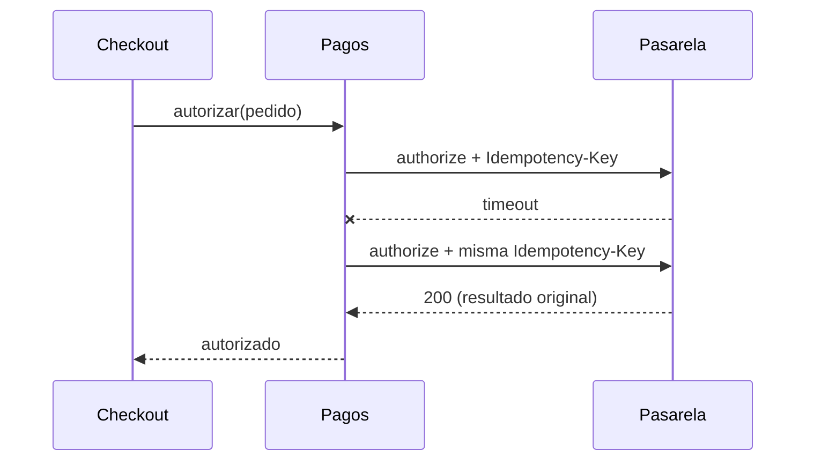

# ADR-0001: Reintentos idempotentes contra la pasarela de pagos

> [!NOTE]
> Contenido ficticio, usado para validar el render de Archidocs.

## Contexto

La pasarela responde con *timeouts* en el **0,8 %** de las autorizaciones en horas pico. Hoy reintentamos sin clave de idempotencia, y en octubre eso produjo **14 cobros duplicados**.

## Decisión

Cada intento de cobro envía una `Idempotency-Key` derivada del pedido y del número de intento lógico:

```ts
const key = sha256(`${order.id}:${attempt.logicalId}`);
await gateway.authorize(payment, { headers: { "Idempotency-Key": key } });
```



## Alternativas consideradas

| Opción | A favor | En contra |
|---|---|---|
| Sin reintentos | Simple | Pierde ventas en cada timeout |
| Reintento sin clave | Recupera ventas | **Duplica cobros** |
| Reintento con clave idempotente | Recupera ventas sin duplicar | La clave debe sobrevivir a reinicios |

## Consecuencias

- [x] La clave se persiste antes del primer intento.
- [x] Los reintentos usan *backoff* exponencial con *jitter*.
- [ ] Alertar si la tasa de reintentos supera el 2 %.

> [!WARNING]
> La pasarela solo garantiza la idempotencia durante **24 h**; un reintento posterior se trata como un cobro nuevo.
