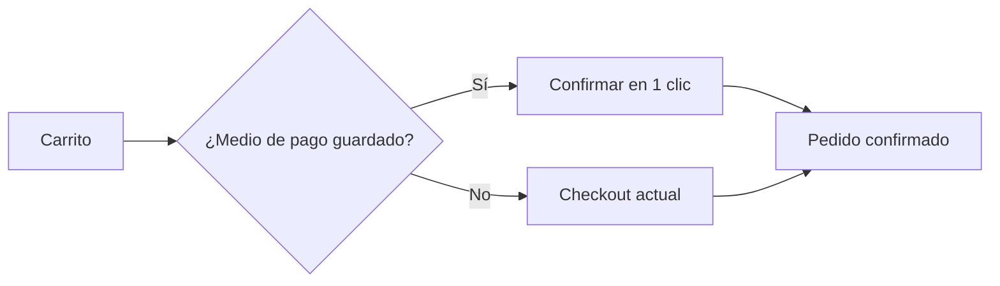

# PRD: Checkout express

> [!TIP]
> Contenido ficticio. Ver también el [ADR de reintentos](../../plataforma/pagos/adr-0001-reintentos-idempotentes/).

## Problema

El **38 %** de los usuarios que llegan al checkout lo abandonan. En entrevistas, 7 de cada 10 citan "demasiados pasos" como motivo principal.

## Objetivos

1. Reducir el checkout de 4 pasos a **1** para clientes con medio de pago guardado.
2. Subir la conversión del checkout del 62 % al **70 %** en 90 días.

## No objetivos

- Rediseñar el carrito.
- Añadir nuevos medios de pago.

## Flujo propuesto

## Métricas

| Métrica | Hoy | Objetivo |
|---|---:|---:|
| Conversión del checkout | 62 % | 70 % |
| Tiempo medio de checkout | 94 s | 20 s |
| Cobros duplicados | 14/mes | 0 |

## Preguntas abiertas

- ¿Pedimos CVV en el checkout express?
- ¿Cómo se comporta con suscripciones?
