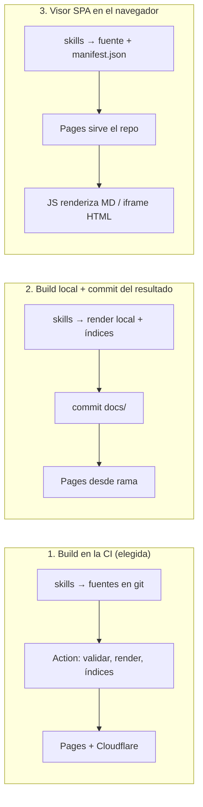

# Design: Archidocs

**Estado:** aprobado para PoC · **Objetivo:** PoC → MVP de uso real en la empresa · **Autores:** Sebastian Vallejo (con Claude) · **Fecha:** 2026-11-10

> "Claude Artifacts fuera de Claude": escribir, publicar, actualizar, eliminar y recuperar documentos HTML o Markdown desde **cualquier agente LLM que soporte skills**, y que otros los vean en un sitio estático privado. No hay UI propia: la interfaz son las skills.

## 1. Contexto y punto de partida

No existe sistema previo (repo vacío). Punto de partida por **referencia** y **arquetipo**:

- **Referencias:** Claude Artifacts (URL estable, actualización en sitio, privado por defecto), Gist + htmlpreview, sitios docs-as-code sobre GitHub Pages (MkDocs/Jekyll), Quarto Pub.
- **Arquetipo:** plataforma interna de publicación de contenido (docs-as-code). Fuerzas dominantes: quién ve, quién publica, URL estable y estándar visual. El volumen no es la fuerza; la **integridad del historial** sí.
- **Hoy:** los artifacts viven dentro de Claude; quien no tiene Claude no puede crearlos ni compartirlos, y no hay un estándar común de estructura ni de UI.

## 2. Requisitos (como delta)

**Funcionales**
- Escribir artifacts guiados por tipo (`adr`, `rfc`, `prd`, `design-doc`, `runbook`, `report`, `explainer`, `note`). Cualquier tipo en MD o HTML. Las plantillas son guía, no obligación.
- Publicar (upsert), actualizar, mover, eliminar, ver historial y **restaurar** cualquier versión o artifact eliminado.
- Si al publicar faltan metadatos o secciones del tipo, la skill los completa por análisis, marcándolos como generados.
- HTML: la skill crea una copia que cumple el estándar de UI (sobrio, profesional, claro/oscuro). Markdown: se ve como Markdown (estilo GitHub).
- Diagramas siempre en Mermaid. En MD se renderizan en el navegador; en HTML se traducen a archify.
- Navegación por carpetas: carpeta = módulo = URL, con índice por módulo y catálogo raíz.

**No funcionales**
- Funciona con cualquier agente que soporte `SKILL.md` (Claude Code, Codex, Copilot, Cursor, Windsurf…).
- Menor dependencia de cloud posible: solo GitHub (y Cloudflare en evaluación). Librerías vendorizadas, sin CDN.
- Historial y recuperación por encima de gobierno: push directo a `main`, sin aprobaciones de contenido.
- Publicado → visible en ≤ 10 min (límite de Pages privado).

**Restricciones**
- Producción: GitHub Enterprise Cloud con **EMU** → Pages **obligatoriamente privado**; ve quien tiene lectura del repo.
- Lectores: solo personas con cuenta GitHub de la empresa; quien quiera ver pide acceso al repo.
- PoC: repo **público** en cuenta personal, contenido ficticio.

**Fuera de alcance**
- UI web propia, roles y aprobaciones, lectores sin cuenta GitHub, permisos por artifact o módulo (ver §11), búsqueda (diferida).

## 3. Números

| Dato | Valor o escenario | Fuente | Decisión que habilita |
|---|---|---|---|
| Personas (autores + lectores) | < 50 | Supuesto ("equipo de varios") | Cloudflare Access Free alcanza; sin cola de publicación |
| Artifacts por año | < 1.000 | Supuesto | Build completo en cada push es viable |
| Publicaciones por día laborable | ~4 | Derivado | Concurrencia en `main` rara pero no nula → CAS por ruta |
| Tamaño de un artifact sin diagramas | < 1 MB | Supuesto | — |
| Tamaño de un HTML de archify | 0,78–0,85 MB (runtime de 785 KB repetido) | **Medido** en `~/.agents/skills/archify` | Render en la CI y presupuesto de tamaño |
| Límite de sitio de Pages | 1 GB; repo recomendado < 1 GB; 100 GB/mes de ancho de banda (blando); deploy ≤ 10 min | Documentación de GitHub (verificada) | Alarma al 70 % |
| Pages privado: tiempo hasta visible | hasta 10 min | Documentación de GitHub | `publish --wait` con timeout de 12 min |
| Cloudflare Zero Trust Free | < 50 usuarios | Fuente secundaria | Reevaluar plan si se supera |

**Umbrales:** con ~1.000 diagramas archify al año el sitio llega a 1 GB en 12–15 meses si se embeben HTML interactivos; el rebuild completo deja de ser razonable por encima de ~5.000 artifacts o 5 min de build; el push directo deja de servir por encima de ~1 publicación por minuto sostenida.

## 4. Alternativas consideradas



| | 1. Build en la CI | 2. Build local | 3. SPA |
|---|---|---|---|
| Publicaciones concurrentes | Solo chocan si editan el mismo artifact | Conflicto en cada push (índices) | Conflicto en `manifest.json` en cada push |
| Mínimo de UI garantizado | Sí, lo aplica el build | Depende de la versión local de cada autor | Solo en la barra externa |
| URLs | Rutas reales | Rutas reales | Hash o truco del `404.html` |
| Requisitos para el autor | `git` + Node | Toolchain completa de render | `git` |
| Depende de Actions | Sí | No | No |

**Elegida la 1.** La 2 y la 3 vuelven a poner en el repo un archivo que editan todos. La 2 solo sería preferible si la org EMU prohibiera Actions (riesgo R7).

## 5. Diseño propuesto

```mermaid
flowchart LR
  subgraph Autor["Máquina del autor (cualquier agente)"]
    subgraph Juicio["Skills archidocs-* (LLM: juicio)"]
      W[write: tipo, plantilla, redacción, Mermaid]
      N[restyle visual del HTML, completar secciones]
    end
    subgraph Mecanica["CLI archidocs (Node: determinista)"]
      V[validate + fidelity check]
      G[git: worktree nuevo, CAS por ruta,\nsin resolver conflictos, errores clasificados]
      WT[publish --wait: build.json en ambos destinos]
      D[doctor · move · delete · history · restore · update]
    end
    W --> N --> V --> G --> WT
    S[(checkout de skills\nfijado a tag de release)] -.symlinks.-> Juicio
  end
  G -->|push| R[(repo archidocs · main\nruleset: sin force-push ni borrado)]
  R -->|on push| CI[GitHub Action\nconcurrency + guard SHA\nvalidar (solo avisa) · cuarentena por artifact\nrender MD · render archify · contenedor + iframe sandbox\níndices · alias · build.json]
  CI --> P[GitHub Pages\nPoC público · prod privado EMU]
  CI --> CF[Cloudflare Workers static assets\n+ Access]
```

### 5.1 Capas

- **Skills (juicio, LLM):** `archidocs-write`, `archidocs-publish`, `archidocs-manage`. Deciden tipo, redactan, adaptan el aspecto del HTML y completan secciones. **Nunca ejecutan git directamente**: invocan el CLI.
- **CLI `archidocs` (mecánica, Node ≥ 18, sin framework):** validación, normalización determinista (metadatos, enlace a `ui.css`), chequeo de fidelidad, operaciones git, espera del deploy, diagnóstico. Es el mismo código que usa la CI.
- **Build (CI):** convierte fuentes en sitio. Nunca bloquea por contenido: pone en cuarentena el artifact roto y publica el resto.
- **Plataforma vs contenido:** `.github/`, `build/`, `skills/`, `standard/` e `install.sh` son plataforma (en producción requieren PR por ruleset); `artifacts/` es contenido (push directo).

### 5.2 Estructura del repo

```
archidocs/
├─ skills/archidocs-{write,publish,manage}/SKILL.md
├─ standard/
│  ├─ STANDARD.md                       # contrato que leen skills, CLI y build
│  ├─ templates/<tipo>.{md,html}
│  ├─ ui/v1/ui.css                      # tokens claro/oscuro + componentes, versionado
│  └─ vendor/                           # mermaid, archify 3.1.0, github-markdown-css (fijados con hash)
├─ build/                               # CLI + build (Node)
├─ artifacts/<modulo>/<submodulo>/<slug>/
│  ├─ index.md | index.html             # copia normalizada (la que se publica)
│  ├─ source.html                       # original del autor (solo HTML)
│  └─ diagrams/<n>.{mmd,json}           # fuentes; archify renderiza en la CI
├─ docs/{design,adr}/
├─ install.sh
└─ .github/workflows/publish.yml
```

### 5.3 Contrato de metadatos

MD → frontmatter YAML; HTML → `<meta name="artifact:<campo>" content="…">`. El **módulo se deriva de la ruta** (no se duplica).

| Campo | Obligatorio | Notas |
|---|---|---|
| `type` | sí | uno de los 8 tipos |
| `title` | sí | |
| `author` | sí | lo completa el CLI desde `git config` |
| `created` / `updated` | sí | `updated` lo gestiona el CLI |
| `status` | sí | `draft` · `review` · `accepted` · `superseded` · `archived` |
| `standard_version` | sí | lo pone el CLI; el build tolera N-1 |
| `tags` | no | |
| `aliases` | no | lo gestiona `move` |
| `generated_sections` | no | secciones completadas por la skill |

### 5.4 Interfaz del CLI

| Comando | Entrada | Salida | Idempotencia / seguridad |
|---|---|---|---|
| `publish <ruta-local> --module <m> [--slug s] [--wait]` | archivo MD/HTML + diagramas | URLs (Pages, Cloudflare), SHA, estado del deploy | Upsert por ruta; sin diff → no commit. CAS: aborta si la ruta cambió en `origin/main` desde la base. Bloquea si el remoto es público salvo `allow_public: true` |
| `validate <ruta>` | artifact | avisos y errores | Puro |
| `move <slug> --to <modulo>` | | URL nueva; vieja en `aliases` | Detecta colisiones antes del commit |
| `delete <slug>` | | SHA | Sin artifact → no-op |
| `history <slug>` | | versiones (SHA, autor, fecha) | Solo lectura |
| `restore <slug> [--at <sha\|fecha>]` | | URL y SHA | Si el slug está ocupado, restaura en una ruta libre |
| `doctor` | | diagnóstico: Node, Chrome (`ARCHIFY_CHROME`), symlinks por agente, credenciales, estado del checkout | Solo lectura |
| `update` | | mueve el checkout de skills al último tag | Explícito, nunca automático |

Comandos añadidos en la implementación de la fase 1: `init --remote` (configuración de usuario en `~/.config/archidocs/config.json`), `standard` y `template <tipo>` (leen el estándar de la versión publicada, así las skills no dependen de rutas locales), `get <ruta>` (descarga la versión actual y su `--if-match`), `module create|describe`, `modules`, `log`. Publicar sobre un artifact existente exige `--if-match` (CAS) u `--overwrite` explícito. La configuración de la instancia (sitios, rama, `allow_public`) vive en `archidocs.config.json` en la raíz del repo. Códigos de salida: 2 validación, 3 conflicto, 4 sin permiso, 5 git, 6 timeout del deploy, 7 módulo inexistente, 8 repo público no permitido, 9 fidelidad insuficiente.

Errores git clasificados: rechazo por desfase → `pull --rebase` + reintento (máx. 3, backoff con jitter); conflicto → aborta y reporta; 401/403 → para y explica (credenciales, CAP); nunca `--force`, nunca `reset --hard` sobre trabajo ajeno, ref de respaldo antes de operar.

### 5.5 Sitio generado

```
/                              catálogo con búsqueda (?q=, type, status, module, sort)
/<modulo>/                     índice del módulo
/<modulo>/<slug>/              contenedor con barra + iframe sandbox (HTML) o MD renderizado
/<modulo>/<slug>/source.md     fuente MD descargable
/<alias>/                      redirect a la URL actual
/_archidocs/v1/ui.css · site.js · vendor/ · build.json · search.json
```

- **HTML:** la página contenedora (barra común: breadcrumb, tipo, estado, autor, fecha, enlace a historial) carga el HTML del autor con `<iframe sandbox="allow-scripts allow-popups allow-top-navigation-by-user-activation" srcdoc=…>` (origen opaco). El HTML crudo nunca se sirve como `.html` del sitio. Los diagramas archify van igual. Se inyecta `<base>` para rutas relativas.
- **Markdown:** render estilo GitHub (`github-markdown-css`), HTML embebido **sanitizado**, Mermaid en el navegador desde `vendor/`.
- `<meta name="robots" content="noindex">` en todas las páginas.
- `build.json`: SHA, fecha, número de artifacts, avisos, cuarentenas, bytes del sitio y del índice de búsqueda.
- **Búsqueda:** el build genera `search.json` (metadatos, encabezados h2/h3 y hasta 6.000 caracteres del texto visible de cada artifact, MD o HTML). `site.js` busca en el navegador: sin tildes ni mayúsculas, todos los términos deben aparecer (AND), con más peso el título, luego etiquetas, tipo, módulo, encabezados, autor y contenido. Filtros por tipo, estado y módulo (incluye submódulos), orden por relevancia, fecha o título, y el estado en la URL para compartir una búsqueda. Cada página tiene una caja compacta (`/` o Ctrl/Cmd+K) que lleva al catálogo; dentro de un módulo, limita la búsqueda a ese módulo.

### 5.6 Módulos y enrutamiento de documentos

Una carpeta bajo `artifacts/` es un **módulo** si tiene `README.md` y un **artifact** si tiene `index.md` o `index.html`. Cada submódulo tiene su propio README. El frontmatter del README es para el LLM; el cuerpo es libre y encabeza el índice del módulo en el sitio.

```yaml
---
title: Pagos
description: Cobros, reembolsos y conciliación con pasarelas.
includes:
  - Decisiones y diseño del flujo de cobro y reembolsos
excludes:
  - Facturación fiscal → finanzas/facturacion
owners: [svallejo]
---
```

**Enrutamiento** (lo usan `archidocs-write` y `archidocs-publish` en artifacts nuevos):

1. `archidocs modules --json` devuelve el árbol con `description`, `includes` y `excludes`.
2. La skill propone el módulo más específico que encaje, con una línea de justificación; un `excludes` que aplique manda el documento al módulo que indica.
3. **Siempre pide confirmación al crear un artifact** (la ruta es la URL); las actualizaciones conservan la ruta y no preguntan.
4. Si ningún módulo encaja, propone crear uno con un README redactado, que se crea con `archidocs-manage` antes de publicar.

**El CLI bloquea publicar en un módulo que no existe o no tiene README**; la creación de módulos es explícita (`archidocs-manage`). La gestión de módulos va en `archidocs-manage` y no en una skill propia: es una operación de estructura, y cada skill extra es otra descripción que cada agente debe cargar y distinguir.

| Comando | Qué hace | Seguridad |
|---|---|---|
| `module create <ruta> --title --description [--includes …] [--excludes …]` | Crea la carpeta y el README | Falla si ya existe |
| `module describe <ruta>` | Actualiza el frontmatter del README | Upsert |
| `module move <ruta> --to <ruta>` | Mueve el módulo con su contenido y registra `aliases` en cada artifact | Puerta de un solo sentido para enlaces, mitigada con alias |
| `modules [--json]` | Árbol con descripciones | Solo lectura |

### 5.7 Instalación

`install.sh` clona dos checkouts en `~/.cache/archidocs/`: `skills/` (fijado a tag de release) y `content/` (sigue `main`, lo usa el CLI). Crea symlinks en `~/.agents/skills/` y en la carpeta de cada agente detectado. Verifica Node ≥ 18 y archify. Actualizar skills: `archidocs update`.

## 6. Decisiones y trade-offs

| Decisión | Resuelve | Empeora | Cambiarla cuando… |
|---|---|---|---|
| Git como almacenamiento, push directo a `main` | Historial y recuperación gratis, sin servidor | Push rechazado en concurrencia; borrar no purga del historial | > 1 publicación/min sostenida, o borrado real exigido por cumplimiento → API + almacenamiento de objetos |
| Build en la CI, un artefacto para dos destinos | Mínimo de UI determinista; hosting intercambiable; índices fuera del repo | 1–10 min entre push y visible; rebuild completo | Build > 5 min o > ~5.000 artifacts → build incremental |
| Pages privado con EMU en producción | Cero infraestructura de identidad | Visibilidad todo o nada | Primer artifact restringido a un subgrupo → espacios (un repo por audiencia) |
| Carpeta = módulo = URL, con `aliases` | Navegación igual al repo | Cada movimiento necesita redirect | > 10 movimientos/mes → URLs planas por ID |
| `ui.css` enlazado y versionado | Un cambio de marca actualiza todo | HTML descargado suelto pierde estilos | Compartir fuera del sitio con frecuencia → exportación autocontenida |
| CLI determinista para git; el LLM nunca ejecuta git | Cadena force-push / lost update / prompt injection | Otro componente; Node obligatorio | Un agente no pueda ejecutar el CLI → skill solo de redacción |
| HTML del autor en iframe sandbox (`srcdoc`, origen opaco) | Ningún artifact lee a los demás | Sin `localStorage`; `<base>` y `target="_top"` necesarios | > 10 % de HTML rotos en el PoC → origen separado para el contenido |
| Commit del original + copia normalizada + fidelity check | Integridad del contenido | Duplica el tamaño de los HTML | Sitio > 500 MB → guardar solo el diff |
| Skills fijadas a tag de release, checkout separado | Una skill rota no llega a todos; no hay estado atascado | Actualizar es explícito | > 1 release/semana → canales stable/beta |
| Diagramas: fuentes en el repo, archify renderiza en la CI | Repo y clones pequeños | La CI necesita Chrome | Sitio > 500 MB → SVG estático + enlace al interactivo |
| Validación: la skill corrige, la CI solo avisa (cuarentena si rompe el build) | Nadie se bloquea por un artifact ajeno | Puede publicarse contenido no conforme | > 10 % de artifacts con avisos → la CI excluye los no conformes |
| Búsqueda en el navegador sobre un `search.json` propio | Sin servidor ni dependencias; filtra por metadatos del estándar | Índice completo en cada búsqueda; ranking simple | `search.json` > 2 MB (~350 artifacts con texto largo) → Pagefind (índice troceado) |
| Librerías vendorizadas con hash | Sin dependencia de CDN; resiste CSP corporativa | Actualización manual | > 2 versiones mayores atrás → script de actualización |

## 7. Fronteras

Un solo contexto (publicación de artifacts). Relaciones externas: GitHub (almacenamiento, CI, hosting, identidad), Cloudflare (hosting alternativo + Access), archify (tercero, conformista, vendorizado). Ver [GLOSSARY.md](../../GLOSSARY.md).

## 8. Fallos y degradación (red team, 2026-11-10)

| # | Riesgo (causa raíz) | Detección | Mitigación | Estado |
|---|---|---|---|---|
| R1 | El LLM opera git a su criterio sin protección de rama (force-push, lost update, clon atascado, bucle con 403) | Nadie | Ruleset sin force-push ni borrado; CLI determinista con CAS y errores clasificados; checkouts separados | Mitigado en diseño |
| R2 | HTML con JS en un mismo origen (exfiltración del sitio privado) | Nadie | Contenedor + iframe sandbox `srcdoc`; MD sanitizado | Mitigado en diseño; validar H3 |
| R3 | La normalización del LLM altera contenido | Nadie | Commit del original; fidelity check (aborta si se pierde > 2 % del texto visible); secciones generadas marcadas | Mitigado en diseño; validar H2 |
| R4 | Cambios de plataforma llegan a todos sin revisión (ui.css, build, skills, robo del token de Cloudflare) | Nadie | Ruleset de rutas de plataforma (prod); skills por tag; `ui.css` versionado; smoke test en cambios de plataforma; token mínimo; acciones por SHA; validar tras el rebase | Parcial en PoC (repo público: sin ruleset de rutas) |
| R5 | Fallos de deploy invisibles (lag, deploys fuera de orden, artifact veneno, divergencia de destinos) | Email al autor del push | `concurrency` + guard SHA; cuarentena por artifact; `build.json`; `publish --wait`; issue automática; chequeo diario | Mitigado en diseño |
| R6 | Tamaño del sitio por archify (0,8 MB por diagrama) | Deploy rojo tarde | Render en la CI; alarma al 70 % de 1 GB; fallback SVG | Mitigado en diseño; medir en H4 |
| R7 | Política de Actions EMU bloquea acciones de despliegue | Primer deploy en prod | Consultar admin antes de migrar; acciones por SHA; fallback sin acciones de terceros | Abierto → H7 |
| R8 | Datos sensibles publicados (PoC público; borrar no purga) | Nadie | CLI bloquea remoto público salvo `allow_public`; push protection; runbook de purga | Riesgo aceptado (ver §12) |
| R9 | Prompt injection entre artifacts y agentes | Nadie | Contenido como datos; git solo vía CLI; ruleset | Mitigado vía R1 |
| R10 | Colisiones en restore/move | Aviso en CI | Detección en el CLI; restore a ruta libre; precedencia ruta real > alias | Mitigado en diseño |
| R11 | Entorno del autor (Node, Chrome para archify, carpetas de skills por agente) | El autor | `archidocs doctor`; archify vendorizado con update check desactivado | Mitigado en diseño |
| R12 | Cloudflare: `workers.dev` sin Access tras un deploy; tope de 50 usuarios | Primer lector bloqueado o nadie | `workers_dev = false`; test sin sesión espera 302/403 | Mitigado en diseño |

**Sistémico:** R1, R4 y R9 son una sola cadena (LLM con shell y push a `main`); el ruleset y el CLI la cortan.

**Puntos ciegos:** política real de Actions/PAT/CAP de la org EMU; `Cache-Control` de Pages privado; OIDC de GitHub → Cloudflare; si `deploy-pages` serializa por sí solo.

## 9. Operación

- **Señales:** `build.json` en ambos destinos; issue automática en el repo cuando falla un deploy; chequeo diario de divergencia SHA Pages/Cloudflare vs `main`; avisos y cuarentenas en el summary del job; `~/.cache/archidocs/log.jsonl` local por publicación (agente, duración, resultado, reintentos, fidelidad).
- **Runbooks** (como artifacts tipo `runbook` en el propio sitio): revertir el sitio (git revert; Cloudflare tiene rollback nativo), restaurar un artifact, desatascar un checkout (`doctor`), rotar el token de Cloudflare, purgar un dato sensible.
- **Bus factor:** token de Cloudflare de la organización y segundo administrador antes de producción.

## 10. Plan del PoC

**Entorno:** repo público en cuenta personal, contenido ficticio, Pages público, Cloudflare Workers static assets + Access (OTP por email). No valida Pages privado, política de Actions EMU ni CAP (→ H7).

| # | Hipótesis | Alcance mínimo | Instrumentación | Éxito | Abandono → pivote |
|---|---|---|---|---|---|
| H1 | Skills + CLI publican de punta a punta sin intervención (inicialmente **solo Claude Code**) | `archidocs-publish` + CLI `publish` (MD) + `install.sh` | `log.jsonl` | ≥ 8/10 publicaciones sin intervención | Skill reducida a "llamar al CLI" |
| H2 | El restyle de HTML por LLM conserva el contenido | Contenedor + normalización + fidelity check | puntaje de fidelidad | ≥ 9/10 HTML variados con ≥ 98 % del texto y validación visual | Normalización solo determinista |
| H3 | El iframe sandbox no rompe artifacts típicos | Contenedor `srcdoc` + `<base>` | revisión manual + consola | ≥ 9/10 se renderizan bien | Origen separado para el contenido |
| H4 | Mermaid → archify funciona y su tamaño es manejable | Skill + render en la CI | bytes por diagrama, tiempo de render | `finalize` ok ≥ 80 %; render CI < 60 s/diagrama | Mermaid en navegador también en HTML |
| H5 | Concurrencia y recuperación cumplen el invariante | Ruleset + CAS + `archidocs-manage` | game day | 0 commits perdidos en 20 intentos; force-push rechazado; restore < 2 min | Cola de publicación (bot de merge) |
| H6 | Comparación Pages vs Cloudflare | Un build, dos destinos | `build.json`, tiempos | p50/p95 push→visible, tasa de fallos, esfuerzo, UX de Access documentados | — (decisión) |
| H7 | Funciona en la org EMU | Copia del repo en la org | deploy, consola | Deploy verde; contenedor funciona en subdominio privado | Cloudflare + Access con IdP corporativo |

**Fases:** (0) esqueleto: repo, ruleset, workflow con `concurrency` y `build.json`, "hola" en ambos destinos; (1) Markdown de punta a punta: CLI, `write` + `publish`, plantillas `adr`/`prd`/`note`, render, índices → H1, H6; (2) HTML: `ui.css` v1, contenedor sandbox, restyle + fidelity, original → H2, H3; (3) diagramas y gestión: archify, presupuesto de tamaño, `archidocs-manage`, game day → H4, H5; (4) cierre: informe del PoC publicado como artifact de Archidocs y decisión de hosting; luego H7.

**Deuda deliberada:** búsqueda; PR obligatorio en rutas de plataforma (no disponible en repo público); runbook de purga; 5 plantillas restantes; espacios multi-repo; exportación autocontenida; validación multi-agente (Codex, Copilot, Cursor, Windsurf).

## 11. Evolución

- **Lo primero que se rompe:** la granularidad de permisos ("quien lee el repo, ve todo"). Movimiento: **espacios** (un repo privado con su Pages por audiencia); la configuración del CLI ya admite varios destinos.
- **Segundo:** tamaño por archify → SVG estático o runtime deduplicado.
- **×10 (≈ 500 autores o > 10.000 artifacts):** build incremental y cola de publicación (bot de merge) o un repo por espacio.

## 12. Temas, preguntas abiertas y riesgos aceptados

### Registro de temas

| Tema | Estado | Decisión | Base |
|---|---|---|---|
| Objetivo | cerrado | PoC → MVP en la empresa | Usuario |
| Visibilidad producción | cerrado | Pages privado con EMU; lectura del repo = puede ver | Documentación GitHub verificada |
| Lectores | cerrado | Solo cuentas GitHub de la empresa | Usuario |
| Hosting PoC | cerrado | Pages y Cloudflare desde el mismo build | Usuario |
| Entorno PoC | cerrado | Repo público personal, contenido ficticio | Usuario |
| Agentes soportados | cerrado | Cualquiera con `SKILL.md`; PoC valida solo Claude Code | Usuario |
| Operaciones | cerrado | Publicar, actualizar, mover, eliminar, historial, restaurar | Usuario |
| Flujo de entrada | cerrado | Push directo a `main` | Usuario |
| Separar skills y hosting | cerrado | Skills → git; Action → hosting | Diseño |
| Identidad, URL, navegación | cerrado | Carpeta = módulo = URL, `aliases` al mover | Usuario |
| Módulos | cerrado | `README.md` con frontmatter (`description`, `includes`, `excludes`); gestión en `archidocs-manage`; el CLI bloquea módulos sin README | Usuario |
| Enrutamiento | cerrado | La skill propone el módulo y siempre confirma al crear un artifact | Usuario |
| Tipos | cerrado | 8 tipos, cualquiera en MD o HTML | Usuario |
| Plantillas | cerrado | Guía; metadatos obligatorios; la skill completa lo que falte | Usuario |
| Metadatos | cerrado | Frontmatter / `<meta artifact:*>`; módulo por ruta | Usuario |
| Render MD | cerrado | Build propio, estilo GitHub | Usuario |
| Búsqueda | cerrado | Cliente sobre `search.json`; título, tipo, estado, módulo, autor, etiquetas y contenido | Usuario; se reabre si el índice > 2 MB |
| Estándar de UI | cerrado | `ui.css` sobrio, claro/oscuro, enlazado y versionado | Usuario |
| Diagramas | cerrado | Mermaid; en HTML vía archify renderizado en la CI | Usuario + red team |
| Validación | cerrado | Skill corrige; CI avisa y pone en cuarentena | Usuario + red team |
| Mecánica git | cerrado | CLI determinista, CAS, ruleset | Red team |
| Aislamiento HTML | cerrado | Iframe sandbox `srcdoc` | Red team; se reabre si H3 falla |
| Distribución de skills | cerrado | `install.sh`, symlinks, checkout por tag, `archidocs update` | Usuario + red team |
| Estructura del repo | cerrado | Un repo (plataforma + contenido) | Usuario; supuesto de restricciones EMU |
| Escala | cerrado (supuesto) | < 50 personas, < 1.000 artifacts/año | Supuesto; se reabre con > 50 lectores |
| Validación multi-agente | diferido | Codex, Copilot, Cursor, Windsurf | Tras H1 con Claude Code |
| Política Actions/PAT/CAP EMU | diferido | Consultar al admin | Antes de H7 |
| Permisos por subgrupo | diferido | Espacios multi-repo | Primer artifact restringido |
| Purga de datos sensibles | diferido | Runbook | Antes de producción |

### Riesgos aceptados

| Riesgo | Por qué se acepta | Cómo se detecta |
|---|---|---|
| Borrar no elimina del historial | El historial es el valor principal | Push protection de secret scanning; revisión de quien publica |
| En el PoC, el ruleset de rutas de plataforma no existe (repo público) | Contenido ficticio y un solo autor | Revisión de commits fuera de `artifacts/` en la CI |
| Visibilidad todo o nada en producción | Un equipo con la misma audiencia | Petición del primer artifact restringido |
| Solo Claude Code valida H1 | Reducir alcance del PoC | Primer autor con otro agente |

### Barrido de bloques

| Bloque | Decisión |
|---|---|
| requirements-scoping, consistency-coordination, resilience-failure, observability, content-delivery | Abiertos (§2, CAS, reintentos clasificados, §9, Pages/Cloudflare) |
| api-design | Abierto como interfaz del CLI (§5.4) |
| data-storage, blob-store | Git como almacenamiento; sin objetos grandes (diagramas en la CI) |
| service-decomposition | Descartado: no hay servicios |
| caching, load-balancing, dns | Descartados: los gestiona el hosting estático |
| messaging-streaming, task-scheduling | Descartados salvo el chequeo diario programado |
| sequencer, sharded-counters | Descartados: la identidad es la ruta |
| distributed-search | Abierto en mínimo: índice estático en el build y búsqueda en el navegador (§5.5) |
| distributed-logging | Descartado: sin servicio en ejecución |

### Rúbrica (0–5)

| Dimensión | Puntos | Qué falta para 5 |
|---|---|---|
| Punto de partida | 4 | Sin sistemas similares estudiados en profundidad |
| Requisitos | 5 | — |
| Números | 4 | Escala basada en supuestos; se medirá en el PoC |
| Interfaces y datos | 4 | Formato exacto de salida JSON del CLI pendiente |
| Trade-offs | 5 | — |
| Fronteras | 4 | Contexto único; relación con archify poco detallada |
| Fallos | 4 | Riesgos de EMU sin verificar (R7) |
| Operación | **3** | Sin SLO formal ni dueño de alertas; runbooks por escribir |
| Experimento | 5 | — |
| Evolución | 4 | Diseño de espacios solo esbozado |

**Total:** 42/50. **Dimensión más débil:** operación.
